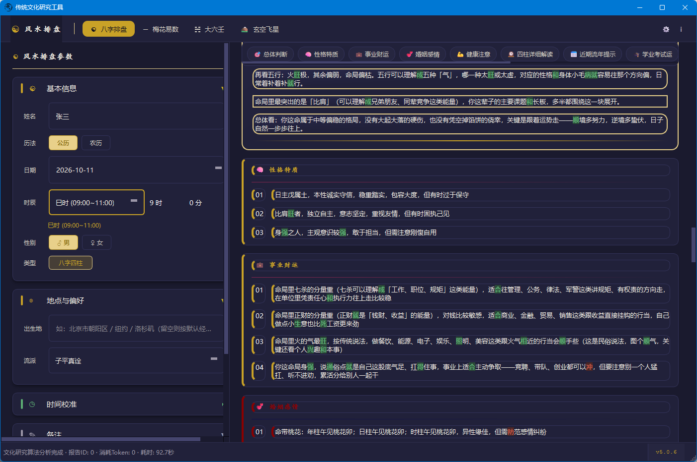
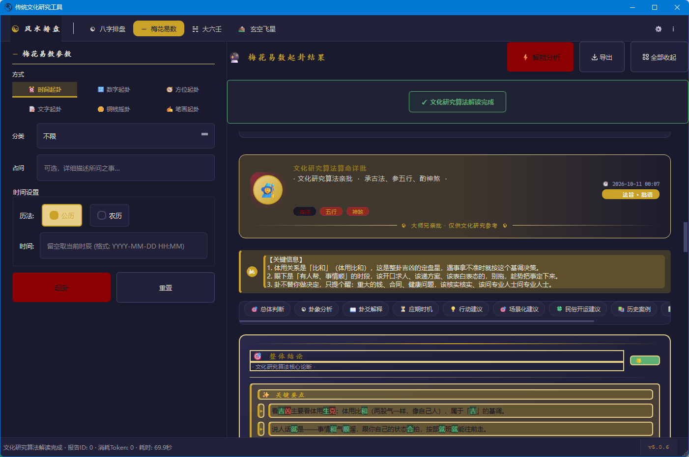
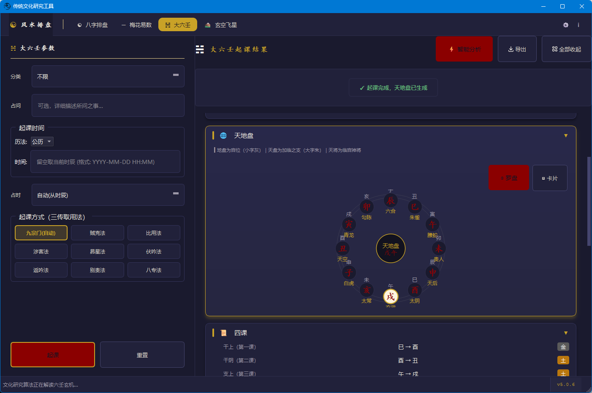
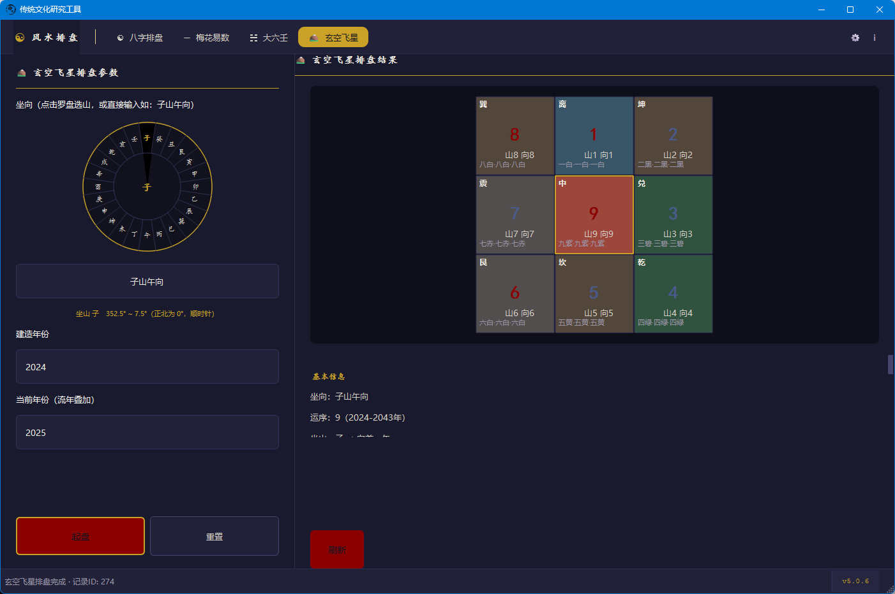
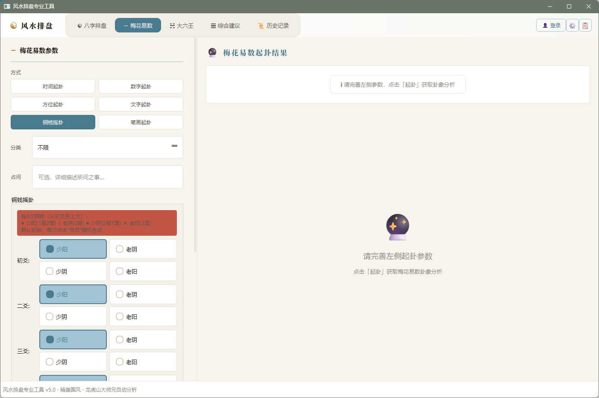

# 🏮 风水排盘专业工具（KP-AI-FENGSHUI）

> 完全本地运行的传统术数排盘桌面应用：集成 **八字 · 梅花易数 · 大六壬 · 玄空飞星** 四大体系，排盘计算 100% 离线，AI 解读可选可关。

[](core/app_version.py)
[](https://www.python.org)
[](https://doc.qt.io/qtforpython/)
[](https://www.microsoft.com/windows)
[]()
[](../../pulls)



*八字排盘 + AI 智能解读 · 深色国风主题（v5.0.6 实拍）*

### ✨ 核心亮点

- 🔒 **排盘 100% 本地离线** —— 出生信息不上传，隐私不出本机
- 🧩 **四大术数体系一体** —— 八字 / 梅花易数 / 大六壬 / 玄空飞星，一个应用搞定
- 🤖 **AI 解读可选可关** —— 未配置也能完整使用，失败时自动降级本地规则解读
- 📄 **专业导出与回溯** —— 一键导出 PDF / Excel / CSV，历史记录本地持久化

### 📑 目录

- **项目概览**：[这是什么](#-这是什么) · [为什么选择本项目](#-为什么选择本项目) · [功能总览](#-功能总览)
- **智能能力**：[AI 智能解读](#-ai-智能解读可选)
- **上手指南**：[快速开始](#-快速开始) · [技术架构](#️-技术架构) · [路线图](#️-路线图)
- **社区与合规**：[参与贡献](#-参与贡献) · [联系方式](#-联系方式) · [免责声明](#️-免责声明) · [许可证](#-许可证)

---

## 📖 这是什么

**KP-AI-FENGSHUI** 是一款面向传统文化研究与学习的 Windows 桌面工具：输入生辰或占问信息，即可在本地完成**八字、梅花易数、大六壬、玄空飞星**四大体系的排盘计算，并附赠可选的 AI 白话解读。

- **所有排盘计算 100% 在本地执行**，不需要联网，不上传任何个人信息；
- **AI 解读是可选增值**：不配置 AI 也能完整使用（自动切换为本地规则解读），配置后可获得更通俗的白话分析；
- 结果支持 **PDF / Excel / CSV 导出**与**本地历史记录回溯**。

> ⚠️ 本工具仅供传统文化研究与娱乐参考。命理学尚未被现代科学证实，不构成任何决策依据，详见[免责声明](#️-免责声明)。

---

## 🎯 为什么选择本项目

市面上的排盘工具普遍存在几个痛点，本项目逐一给出解决思路：

| 常见痛点 | 本项目的做法 |
|---------|-------------|
| 在线工具需要注册，出生信息上传云端 | 排盘计算全部本地执行，数据保存在本机 SQLite，**不上传任何信息** |
| AI 解读是摆设：不联网就完全不可用 | AI **可选且可降级**——未配置或调用失败时，自动切换为本地规则引擎解读，功能不缺失 |
| 想学命理要装 N 个工具，一个体系一个应用 | **四大体系集成于同一应用**，输入、历史记录、导出、设置体验完全统一 |
| 网页排盘结果转瞬即逝，截图排版混乱 | **PDF / Excel / CSV 三格式专业导出** + 本地历史记录（多条件筛选、一键载入） |
| AI 解读满嘴套话、无据妄断 | 提示词强制约束：**只依据排盘数据、引用古籍须注明出处、术语随文白话解释、概率留余地**，并注入本地古籍知识库原文片段作参考 |
| 出生信息敏感，担心密钥与数据安全 | AI 密钥经设备指纹派生混淆后落盘（源码无明文密钥），日志自动脱敏 |

---

## ✨ 功能总览

应用包含四大排盘板块 + 历史记录 + 导出能力，全部在同一个窗口内切换。

### 1️⃣ 八字排盘


- **公历 / 农历**双历输入，支持出生地经度自动**真太阳时修正**与时间校准
- 四柱干支、十神、五行旺衰量化、命局类型（身强身弱 / 格局 / 用神）判定
- **大运流年**、十二长生推演，时间轴可视化展示
- AI 解读章节：总体判断、性格特征、事业财运、婚姻感情、健康注意、四柱详解、近期流年、学业考试、民俗开运建议、概率统计等 10+ 板块

### 2️⃣ 梅花易数



- **6 种起卦方式**：时间起卦、数字起卦、方位起卦、文字起卦、铜钱摇卦、笔画起卦
- 本卦 / 互卦 / 变卦、体用生克、动爻解析、应期推断
- AI 解读章节：总体判断、卦象分析、爻辞解释、应期时机、行动建议、场景化建议、历史案例等

### 3️⃣ 大六壬



- **9 种起课方式**（三传取用法）：九宗门（自动）、贼克、比用、涉害、昴星、伏吟、返吟、别责、八专
- **天地盘环形可视化** + 卡片双视图，四课、三传、十二天将、神煞逐项展示
- AI 解读章节：总体判断、课体分析、天将详解、分类占断、应期时机等

### 4️⃣ 玄空飞星



- **罗盘点选二十四山**定坐向（如「子山午向」352.5°~7.5°），实时显示度数区间
- 建造年份自动定元运，支持**流年飞星叠加**
- **九宫飞星盘** 3×3 彩色渲染，山星 / 向星 / 运星一目了然
- 纯本地计算与可视化（该板块暂无 AI 解读）

### 🗂️ 历史记录与导出（通用能力）



- 排盘结果自动落库（本地 SQLite），支持按**类型、姓名、日期区间、五行、格局、强弱**多条件筛选
- 一键**载入到八字**复现当时排盘，支持批量删除
- **导出**：PDF（排版报告）、Excel（结构化数据）、CSV（轻量格式）

---

## 🤖 AI 智能解读（可选）

AI 解读采用「**确定性计算 + 可选 AI 润色**」的双轨设计：

```
排盘数据（本地确定性计算）
      │
      ├──►  界面直接展示（不依赖任何网络）
      │
      └──►  AI 解读（可选）
              ├── 检索本地古籍知识库 → 注入参考原文
              ├── 发送结构化排盘 JSON 至你配置的模型端点
              ├── 返回结构化 JSON，多级容错解析
              └── 失败 / 未配置 → 自动降级为本地规则解读
```

**如实说明几件事：**

- ✅ **未配置 AI 也能完整使用**：所有排盘功能离线可用，AI 不可用时自动降级为本地规则解读，不弹空窗；
- ✅ **解读有约束**：提示词要求模型只依据排盘数据作答、引用古籍注明出处、术语用大白话解释、不承诺结果、附免责声明；
- ✅ **默认接入 Agnes AI** 预设，也**支持自定义任意 OpenAI Chat Completions 兼容端点**（在设置中填写 API 地址、模型名与密钥）；
- ✅ **密钥安全**：密钥以设备指纹派生密钥混淆后落盘，源码与配置中均无明文；日志自动脱敏；
- ✅ **结果本地缓存**：相同排盘的 AI 结果缓存于本地，避免重复消耗 Token；
- ℹ️ 目前 AI 解读覆盖**八字 / 梅花易数 / 大六壬**三个板块，玄空飞星暂不支持；
- ℹ️ 状态栏实时显示本次分析的 Token 消耗与耗时。

---

## 🚀 快速开始

### 环境要求

- Windows 10 及以上
- Python 3.10+

### 从源码运行

```bash
git clone <本仓库地址>
cd KP-AI-FENGSHUI
pip install -r requirements.txt

python main.py
```

> 首次启动会自动初始化本地数据库（`data/fengshui.db`），无需手动建库。

### 配置 AI 解读（可选）

1. 点击主窗口右上角 **⚙ 设置** → AI 配置；
2. 填写 API 地址、模型名称与 API Key（可使用内置 Agnes AI 预设，或任意 OpenAI 兼容端点）；
3. 保存后即可在各板块点击「智能分析」获得 AI 解读。

不配置也完全可以正常使用全部排盘功能。

### 打包为 EXE（可选）

```bash
python scripts/build_release.py
```

---

## 🏗️ 技术架构

```
┌─────────────────────────────────────────────────┐
│  界面层 ui/                                      │
│  PySide6 · 深色国风主题 · 四板块输入/结果面板      │
│  大运时间轴 · 九宫飞星盘 · 天地盘环形图 · 导出对话框│
├─────────────────────────────────────────────────┤
│  业务编排层 service/ · ai/ · api/                 │
│  排盘服务 · AI 解读工作线程（QThread）· 接口客户端 │
├─────────────────────────────────────────────────┤
│  计算核心层 core/                                 │
│  bazi/ 八字  · divination/ 梅花+六壬              │
│  fengshui/ 玄空 · astronomy/ 真太阳时             │
│  calendar_utils 历法 · knowledge/ 古籍知识库      │
├─────────────────────────────────────────────────┤
│  数据层                                          │
│  SQLite 本地库（排盘历史 / AI 缓存）· 种子数据     │
└─────────────────────────────────────────────────┘
```

**技术栈**

| 层面 | 选型 |
|------|------|
| 界面 | PySide6（Qt for Python） |
| 排盘核心 | 纯 Python 实现（历法 / 天文计算 / 术数算法），无网络依赖 |
| 数据校验 | Pydantic v2 |
| 数据存储 | SQLite（本地单文件） |
| AI 接口 | OpenAI Chat Completions 兼容协议（requests 直连） |
| 导出 | reportlab（PDF）· openpyxl（Excel）· CSV |
| 数值处理 | numpy · pandas |
| 打包 | PyInstaller |

**工程质量**：项目在开发过程中维护了 830+ 项单元测试回归，以及 `scripts/` 下 30 余道自动化审计 / 验证脚本（静态分析、QSS 规则审计、对比度审计、离屏 UI 采样验证、冷启动性能门禁等）。

### 项目结构

```
KP-AI-FENGSHUI/
├── main.py              # 程序入口（含 DLL 加载与启动诊断）
├── ui/                  # 界面层：面板、组件、导出
├── service/             # 业务编排：排盘服务、综合建议
├── core/                # 计算核心：bazi / divination / fengshui / knowledge / astronomy
├── api/                 # AI 接口客户端
├── ai/                  # AI 解读渲染相关
├── database/            # SQLite Schema 与种子数据
├── scripts/             # 构建、审计、验证脚本
├── assets/  images/     # 图标与界面截图
└── data/                # 运行期本地数据库（自动生成，不入库）
```

---

## 🗺️ 路线图

- [ ] 古籍知识库由 BM25 关键词检索升级为向量检索（ChromaDB），提升召回质量
- [ ] 玄空飞星板块补齐 AI 解读
- [ ] macOS / Linux 平台适配
- [ ] 更多起卦 / 起课方式与术语白话词典

欢迎通过 Issue 提出功能建议。

---

## 🤝 参与贡献

欢迎一切形式的贡献：

- 🐛 提交 [Issue](../../issues) 反馈 Bug 或算法误差（附排盘输入与期望结果更佳）
- 💡 发起讨论：算法依据、界面改进、新板块设想
- 🔧 提交 Pull Request：请保持改动聚焦，并说明修改动机与验证方式

---

## 💬 联系方式

**KP 工作室**

| 渠道 | 信息 |
|------|------|
| QQ | 1153602036 |
| 微信 / 手机同号 | 19258585274 |

| QQ 联系 | 微信联系 |
|:---:|:---:|
|  |  |

*如需学术合作、技术咨询或二次开发定制，欢迎联系。*

---

## ⚠️ 免责声明

**本工具仅供传统文化研究与娱乐参考，不构成任何医疗、法律、财务或人生决策依据。**

- 命理学尚未被现代科学证实，本项目不宣称任何科学性；
- AI 解读内容由大语言模型基于排盘数据与古籍参考生成，属参考性内容，非事实陈述；
- 涉及健康、法律、投资等重大事项，请咨询相关专业人士；
- 如使用 AI 解读功能，请确保 API 密钥来源合法，并自行承担第三方数据处理风险。

---

## 📄 许可证

本项目当前**尚未附带正式开源许可证**。在许可证确定之前，仓库内容默认保留所有权利，欢迎学习、研究与交流；如需引用、分发或二次开发，请先通过[联系方式](#-联系方式)与作者沟通。
